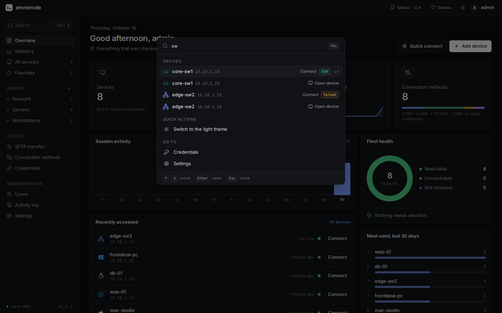

# emremote

[](https://github.com/emremrangz/emremote/actions/workflows/ci.yml)
[](LICENSE)

**Self-hosted, browser-based remote access for the computers on your network.**
Open RDP, VNC, SSH and Telnet sessions in a browser tab, with no agent installed on the target computers.

## Screenshots

| | |
|---|---|
| <br>**Overview**: reachability, live sessions and recent activity | <br>**Devices**: groups, tags, search and one-click connect |
| <br>**Switches and routers**: vendor, firmware, model and serial read over SSH | <br>**Workspace**: sessions as tabs, one to four panes |
| <br>**Statistics**: usage by day and hour, fleet and security | <br>**Activity log**: every sign-in, session and file transfer |
| <br>**Switch health**: CPU, memory, firmware and uptime | <br>**Terminal themes** with a live preview |
| <br>**Ctrl/⌘ K**: find devices and run quick actions | <br>**Sign-in** as a terminal |

## Features

- **RDP, VNC, SSH and Telnet in the browser**, with tabs, split panes and a screenshot button.
- **Device inventory** with groups, tags, search, and import/export.
- **Files**: SFTP file manager, RDP transfer drive, and copy between servers.
- **Details without an agent**: OS, hardware, VM or physical, over SSH.
- **Users and teams**, two-factor sign-in, an audit log and an encrypted password vault.
- **Extras**: view-only session sharing, Wake-on-LAN, jump hosts, terminal themes.

## Setup

**You need** a computer on your network with Docker and Docker Compose v2 (a Linux machine, a VM, or a
Proxmox LXC container with nesting enabled). Nothing is installed on the computers you want to reach.

**1. Install.** One command downloads the images and starts everything:

```bash
curl -fsSL https://raw.githubusercontent.com/emremrangz/emremote/main/scripts/install.sh | sh
```

or by hand (copy and paste; `hostname -I` fills in this machine's address):

```bash
cd ~ && git clone https://github.com/emremrangz/emremote.git && cd emremote
./scripts/init-env.sh $(hostname -I | awk '{print $1}')   # writes .env with fresh secrets
docker compose up -d                                       # pulls the images and starts everything
```

The installer generates the database password and the encryption key for you and stores them in `.env`.
If ports 80 and 443 are already taken (for example by Nginx Proxy Manager), it picks free ones and prints
the address to open, such as `https://192.168.1.50:8444`.
**Back up `EMREMOTE_ENCRYPTION_KEY` from that file**: without it, saved passwords cannot be recovered.

**2. Create the administrator.** Open `https://<that address>`. The first screen asks for a username and
password and signs you in right away. No token is needed; the screen is only offered to computers on a
private network, and it closes for good once the account exists. If emremote is reachable from outside,
set `EMREMOTE_SETUP_TOKEN` in `.env` to require a token as well (see [docs/SECURITY.md](docs/SECURITY.md)).

**3. Trust the certificate (optional).** emremote serves HTTPS with a certificate from its own local CA, so
the browser warns once. Trust that CA to make the warning go away:
[docs/DEPLOYMENT.md](docs/DEPLOYMENT.md#trusting-the-local-certificate-authority).

**4. Add a device.** Choose **Add device**, pick its operating system and connection methods (RDP, VNC,
SSH or Telnet) and save the sign-in. [docs/CONNECTIONS.md](docs/CONNECTIONS.md) explains what to switch on
on Windows, macOS and Linux. Limit which networks emremote may reach with `EMREMOTE_ALLOWED_TARGET_NETWORKS`
in `.env` (it defaults to private ranges).

**Update:**

```bash
~/emremote/scripts/update.sh                    # backup, pull, restart, health check; run it from any folder
```

**Back up:** `scripts/backup.sh`.

> **Status: 0.1.** Built for a trusted home or lab network. Read [docs/SECURITY.md](docs/SECURITY.md)
> before exposing it further, and [docs/LIMITATIONS.md](docs/LIMITATIONS.md) for what is not done yet.

## Documentation

[Deployment](docs/DEPLOYMENT.md) · [Connections](docs/CONNECTIONS.md) · [Users](docs/USERS.md) ·
[Security](docs/SECURITY.md) · [Architecture](docs/ARCHITECTURE.md) · [Development](docs/DEVELOPMENT.md) ·
[Troubleshooting](docs/TROUBLESHOOTING.md) · [Limitations](docs/LIMITATIONS.md)

## Support the project


Thank you for your support!

## Contributing

Issues and pull requests are welcome, see [CONTRIBUTING.md](CONTRIBUTING.md). Report security problems
as described in [SECURITY.md](SECURITY.md).

## License

[Apache License 2.0](LICENSE). It builds on [Apache Guacamole](https://guacamole.apache.org/)'s `guacd`
and JavaScript client, see [NOTICE](NOTICE). Operating-system logos belong to their owners and are shown
only to identify the systems; emremote is not affiliated with them.
