# emremote

[](https://github.com/emremrangz/emremote/actions/workflows/ci.yml)
[](LICENSE)

**Self-hosted, browser-based remote access for the computers on your network.**
Open RDP, VNC, SSH and Telnet sessions in a browser tab, with no agent installed on the target computers.

## Screenshots

| | |
|---|---|
| 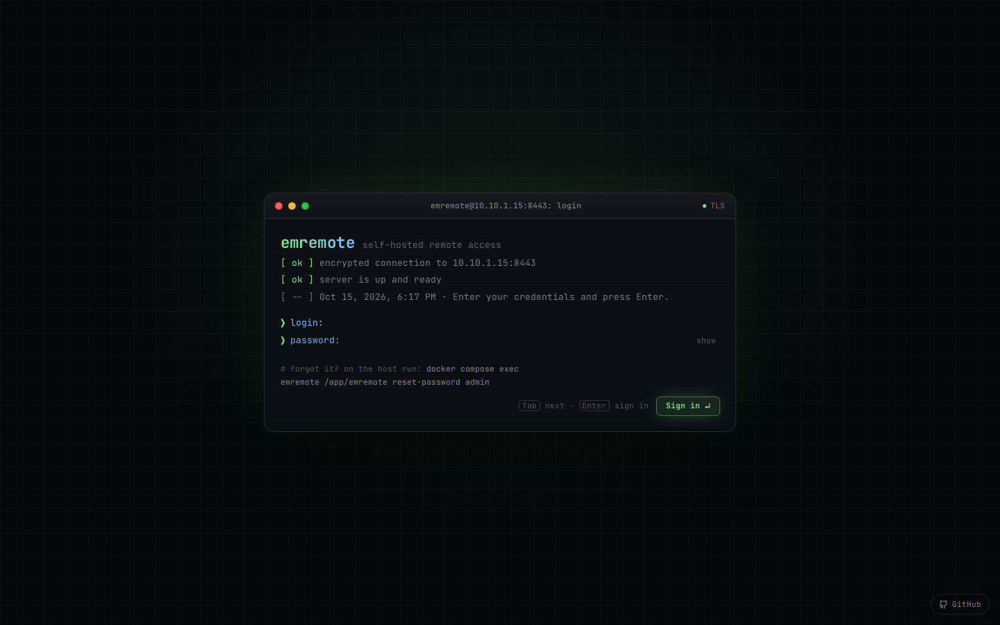<br>**Sign-in** as a terminal: type each line, answer "remember me" | 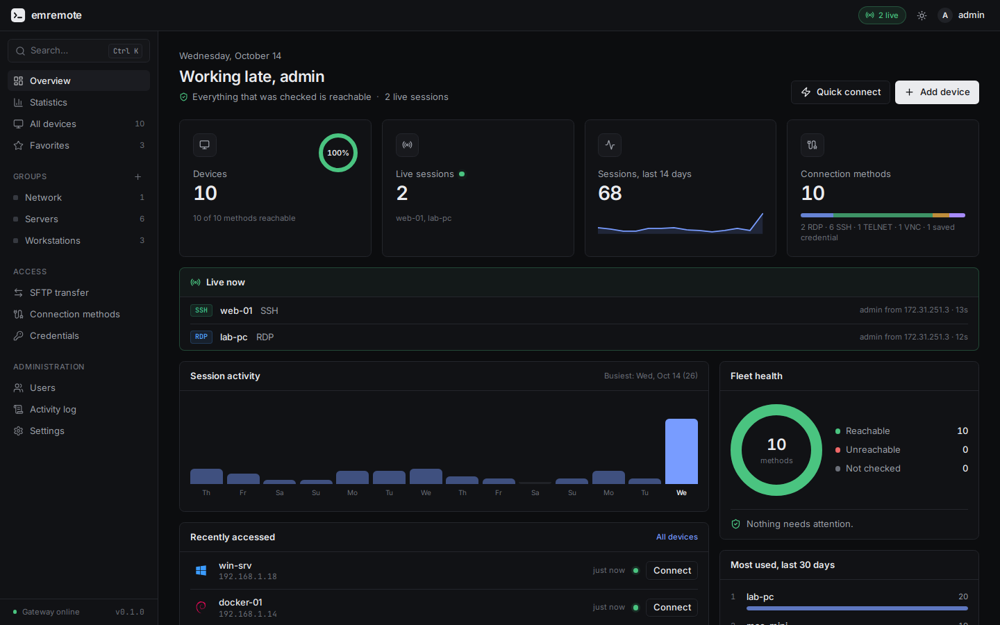<br>**Overview**: reachability, live sessions and recent activity |
| 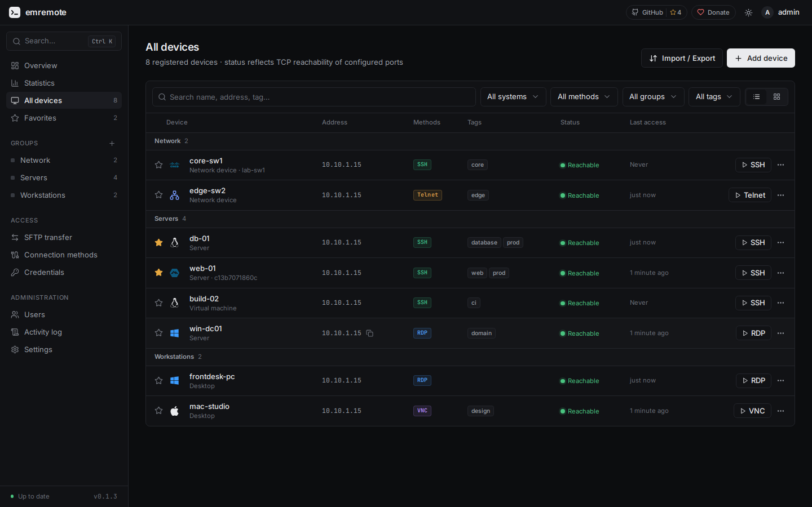<br>**Devices**: groups, tags, search and one-click connect | 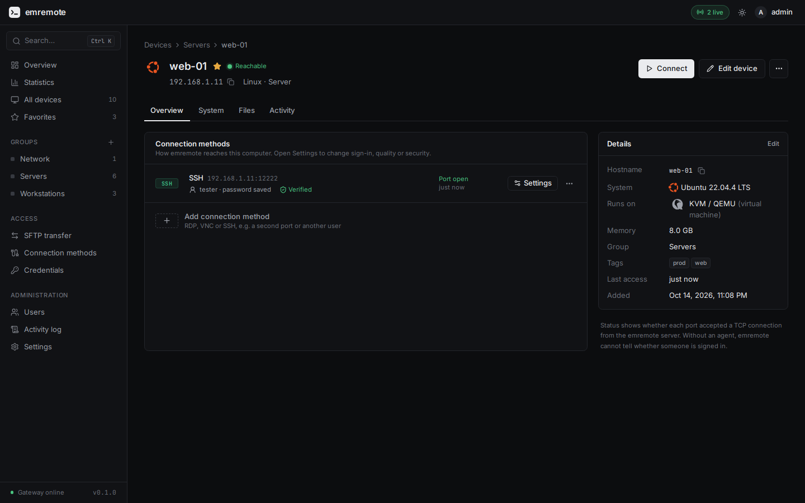<br>**Switches and routers**: vendor, firmware, model and serial read over SSH |
| 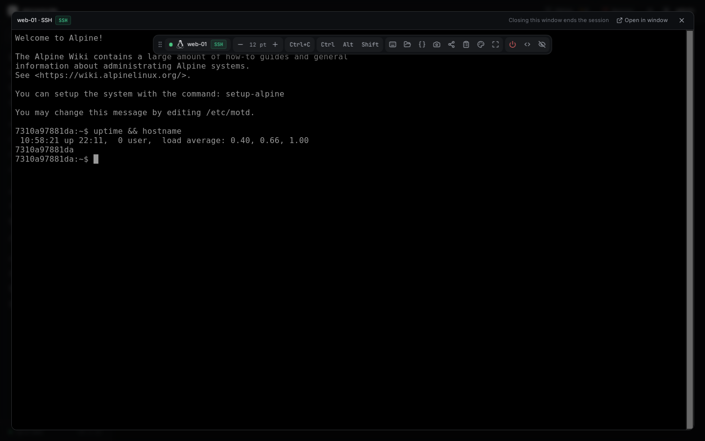<br>**Quick view**: a session in a window over the page you are on | 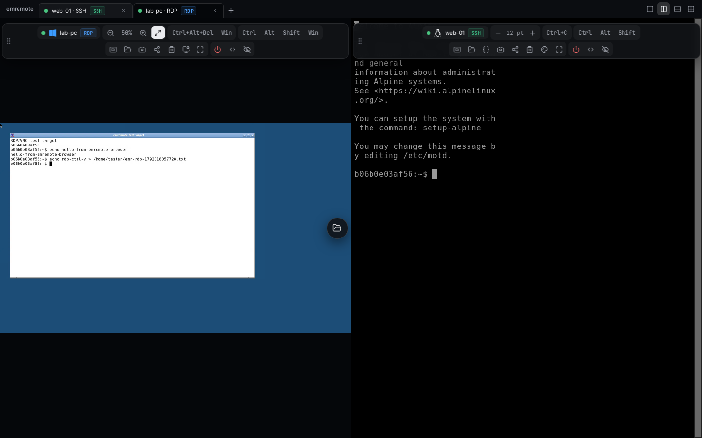<br>**Workspace**: sessions as tabs, one to four panes |
| 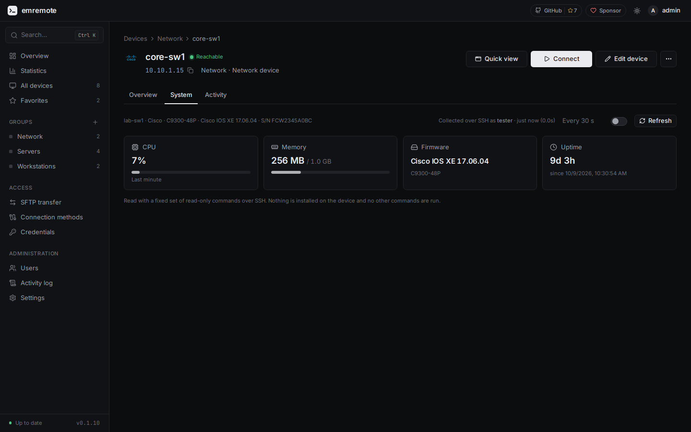<br>**Switch health**: CPU, memory, firmware and uptime | 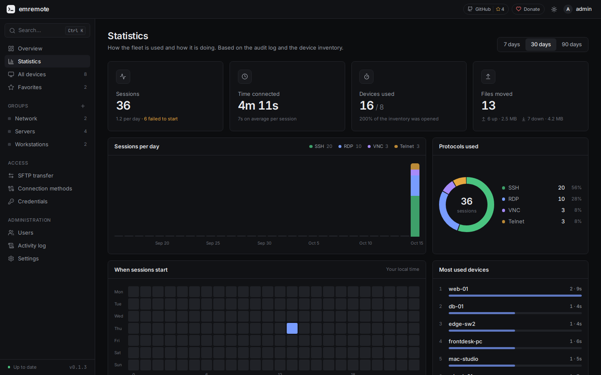<br>**Statistics**: usage by day and hour, fleet and security |
| 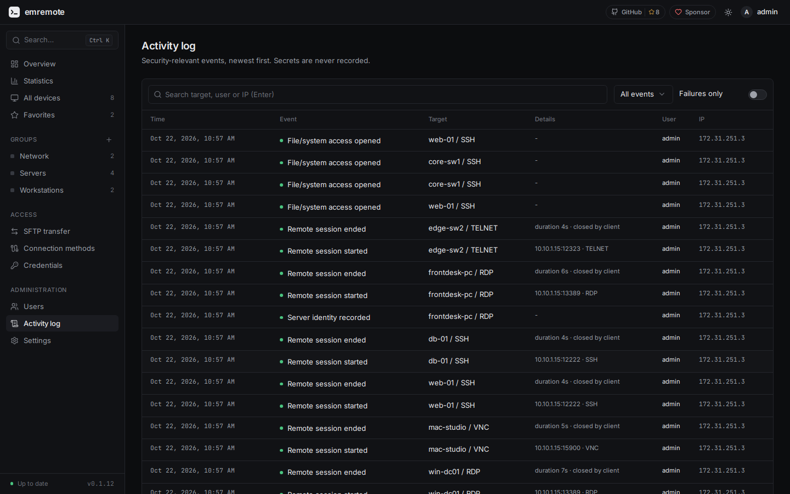<br>**Activity log**: every sign-in, session and file transfer | 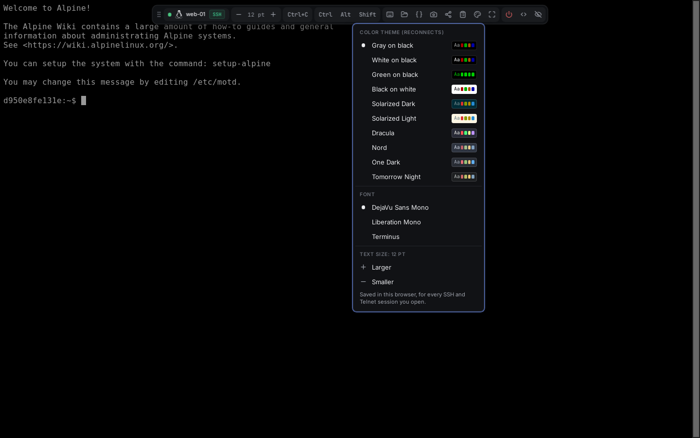<br>**Terminal themes** with a live preview |
| 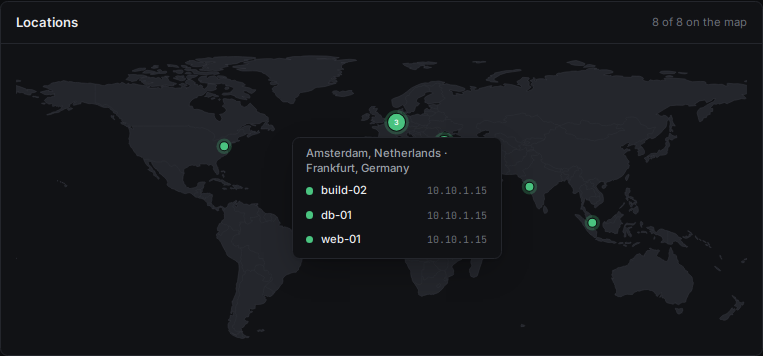<br>**Map**: where your servers are, nearby ones grouped | 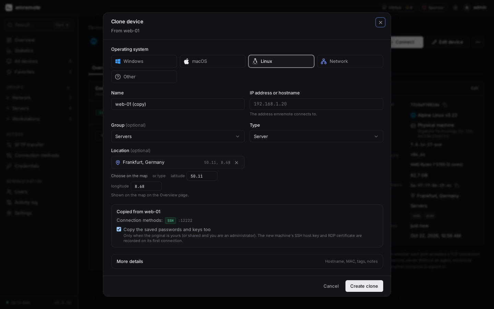<br>**Clone a device**: same kind, methods and sign-ins, a new name and address |

## Features

- **RDP, VNC, SSH and Telnet in the browser**, with tabs, split panes and a screenshot button.
- **Device inventory** with groups, tags, search, locations on a world map, cloning, and import/export.
- **Files**: SFTP file manager, RDP transfer drive, and copy between servers.
- **Details without an agent**: OS, hardware, VM or physical, over SSH.
- **Vault for privileged accounts**: passwords, SSH keys, API tokens and notes; show with a reason,
  exclusive check-out, approval requests, break-glass, password rotation on Linux, history and a health report.
- **Users and teams**, two-factor sign-in and an audit log.
- **Extras**: view-only session sharing, Wake-on-LAN, jump hosts, terminal themes.

## Setup

**You need** a computer on your network with Docker and Docker Compose v2 (a Linux machine, a VM, or a
Proxmox LXC container with nesting enabled). Nothing is installed on the computers you want to reach.

**1. Install.** One command downloads the images and starts everything:

```bash
curl -fsSL https://raw.githubusercontent.com/emremrangz/emremote/main/scripts/install.sh | sh
```

or by hand (copy and paste; `hostname -I` fills in this machine's address):

```bash
cd ~ && git clone https://github.com/emremrangz/emremote.git && cd emremote
./scripts/init-env.sh $(hostname -I | awk '{print $1}')   # writes .env with fresh secrets
docker compose up -d                                       # pulls the images and starts everything
```

**Without git or curl: install from the ZIP file.** On the
[Releases page](https://github.com/emremrangz/emremote/releases/latest) download the source ZIP, copy it to
the machine that runs Docker and unpack it:

```bash
unzip emremote-*.zip && cd emremote-*/                     # the folder name carries the version
./scripts/init-env.sh $(hostname -I | awk '{print $1}')    # writes .env with fresh secrets
docker compose pull                                        # downloads the images (no build needed)
docker compose up -d                                       # starts everything
```

No shell script available (for example Docker Desktop on Windows)? Copy `.env.example` to `.env` and fill in
`EMREMOTE_SITE_ADDRESS` (the address you will open), `POSTGRES_PASSWORD` and `EMREMOTE_ENCRYPTION_KEY`
(any long random strings; keep the key safe), then run the last two commands. Without a tag the images are
the newest release (`latest`); to stay on exactly the version of your ZIP, add
`EMREMOTE_IMAGE_TAG=<version>` (for example `0.1.7`) to `.env`. Later updates work like for any other
install: `scripts/update.sh`.

The installer generates the database password and the encryption key for you and stores them in `.env`.
If ports 80 and 443 are already taken (for example by Nginx Proxy Manager), it picks free ones and prints
the address to open, such as `https://192.168.1.50:8444`.
**Back up `EMREMOTE_ENCRYPTION_KEY` from that file**: without it, saved passwords cannot be recovered.

**2. Create the administrator.** Open `https://<that address>`. The first screen asks for a username and
password and signs you in right away. No token is needed; the screen is only offered to computers on a
private network, and it closes for good once the account exists. If emremote is reachable from outside,
set `EMREMOTE_SETUP_TOKEN` in `.env` to require a token as well (see [docs/SECURITY.md](docs/SECURITY.md)).

**3. Trust the certificate (optional).** emremote serves HTTPS with a certificate from its own local CA, so
the browser warns once. Trust that CA to make the warning go away:
[docs/DEPLOYMENT.md](docs/DEPLOYMENT.md#trusting-the-local-certificate-authority).

**4. Add a device.** Choose **Add device**, pick its operating system and connection methods (RDP, VNC,
SSH or Telnet) and save the sign-in. [docs/CONNECTIONS.md](docs/CONNECTIONS.md) explains what to switch on
on Windows, macOS and Linux. Limit which networks emremote may reach with `EMREMOTE_ALLOWED_TARGET_NETWORKS`
in `.env` (it defaults to private ranges).

**Update.** Administrators see **Update available** in the sidebar when a newer release exists. Two ways to install it:

```bash
~/emremote/scripts/update.sh                    # on the server: backup, pull, restart, health check; run it from any folder
```

or from the browser: the same notice opens a window with an **Update now** button that backs up the database,
downloads the new version, restarts, checks that it is healthy (going back to the old version if not) and
reloads the page. That button needs the **optional updater**, which is **off by default** on purpose: it is a small
extra container that holds the Docker socket, which is root-equivalent on the host. emremote itself never gets the
socket, and the updater only reacts to a request file and runs the same fixed steps each time. To turn it on:

```bash
echo 'COMPOSE_PROFILES=updater' >> .env && docker compose up -d     # in the install folder
```

Without it the window shows the command to run on the server instead. Details and limits:
[docs/DEPLOYMENT.md](docs/DEPLOYMENT.md#updating-from-the-interface-optional).

**Back up:** `scripts/backup.sh`.

> **Status: 0.1.** Built for a trusted home or lab network. Read [docs/SECURITY.md](docs/SECURITY.md)
> before exposing it further, and [docs/LIMITATIONS.md](docs/LIMITATIONS.md) for what is not done yet.

## Locked out?

- **Forgot a password:** an administrator sets a new one under **Users**. If you are the only administrator,
  run `docker compose exec emremote /app/emremote reset-password <username>` in the install folder (saved
  connection passwords can then only be kept if another user holds the key, see
  [docs/DEPLOYMENT.md](docs/DEPLOYMENT.md#account-recovery)).
- **Lost the authenticator app:** type one of your 10 recovery codes in the code line of the sign-in screen.
  Without one, an administrator opens your entry under **Users** and chooses **Reset two-factor**. If you are
  the only administrator, run `docker compose exec emremote /app/emremote reset-2fa <username>` on the server.
  Your password and saved passwords stay as they are; sign in and set two-factor up again under **Settings**.

## Documentation

[Deployment](docs/DEPLOYMENT.md) · [Connections](docs/CONNECTIONS.md) · [Vault](docs/VAULT.md) · [Session recording](docs/RECORDING.md) · [Users](docs/USERS.md) ·
[Security](docs/SECURITY.md) · [Architecture](docs/ARCHITECTURE.md) · [Development](docs/DEVELOPMENT.md) ·
[Troubleshooting](docs/TROUBLESHOOTING.md) · [Limitations](docs/LIMITATIONS.md)

## Support the project

emremote is free and open source, built and maintained in spare time. If it saves you time:

[](https://github.com/sponsors/emremrangz)
[](https://github.com/emremrangz/emremote)

- **Sponsor** the work on [GitHub Sponsors](https://github.com/sponsors/emremrangz): a one-time or monthly
  amount keeps releases and fixes coming.
- **Star** the repository; it helps other people find it.
- **Report** a bug or an idea in the [issues](https://github.com/emremrangz/emremote/issues), or tell a
  colleague who manages servers.

## Contributing

Issues and pull requests are welcome, see [CONTRIBUTING.md](CONTRIBUTING.md). Report security problems
as described in [SECURITY.md](SECURITY.md).

## License

[Apache License 2.0](LICENSE). It builds on [Apache Guacamole](https://guacamole.apache.org/)'s `guacd`
and JavaScript client, see [NOTICE](NOTICE). Operating-system logos belong to their owners and are shown
only to identify the systems; emremote is not affiliated with them.
